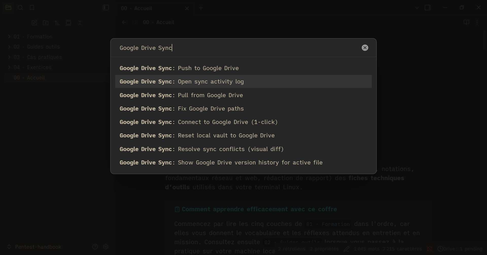

<h1 align="center">Google Drive Sync</h1>

Google Drive Sync provides secure, frictionless, and zero-server synchronization between your local Obsidian vault and Google Drive across desktop and mobile devices.

Designed around a local-first philosophy, the plugin establishes a direct connection between your device and Google Drive without routing your notes through any proprietary intermediate backend or proxy servers. Your files, revision metadata, and authentication tokens remain strictly between your Obsidian client and your personal Google account.

For users demanding complete confidentiality, Google Drive Sync includes optional zero-knowledge end-to-end encryption. Vault files are encrypted locally using AES-256-GCM and PBKDF2-SHA256 before upload, ensuring that neither Google nor anyone else can inspect your notes without your master passphrase.

Built-in safety features protect against data loss in multi-device workflows: visual side-by-side conflict resolution ensures conflicting edits are never overwritten silently, Google Drive revision history allows restoring older snapshots on demand, and resilient network retry mechanisms ensure reliable syncing even on unstable mobile connections.

## Features

- **One-click connect**: Sign in with your Google account in seconds.
- **Automatic sync**: Sync notes in the background, or manually on demand.
- **Conflict resolution**: Compare conflicting changes side by side without losing notes.
- **Version history**: Browse and restore past revisions from Google Drive.
- **Activity log**: View real-time sync actions in a dedicated sidebar view.
- **Exclusion rules**: Ignore specific files or folders.
- **Optional end-to-end encryption**: Encrypt notes locally before uploading to Google Drive.
- **Direct and private**: Direct transfer to Google Drive. No third-party servers, no tracking.

## Getting started

1. Install and enable **Google Drive Sync** from Community plugins.
2. Select **Connect with Google Drive** in the plugin settings.
3. Approve access in your browser.

Your vault is connected and ready to sync.

## Usage

### Daily synchronization

- **Ribbon icon**: Click the sync icon in the left ribbon to upload local changes to Google Drive immediately.
- **Automatic sync**: When enabled in plugin settings, notes sync in the background. The plugin pulls remote updates on startup and uploads local edits, new notes, renames, and deletions after a short pause.
- **Command palette**: Use the command palette to trigger specific actions:
  - **Push to Google Drive**: Upload local changes.
  - **Pull from Google Drive**: Download remote modifications.
  - **Reset local vault to Google Drive**: Align the local vault with Google Drive.

### Version history and recovery

- Right-click any Markdown note in the file explorer or active editor, then select **Google Drive: Version history**.
- Alternatively, run the command **Show Google Drive version history for active file**.
- Browse past revisions saved in Google Drive and restore any version with one click.

### Conflict resolution

- When a file is modified on two devices at once, the plugin prevents silent overwrites by flagging the conflict.
- Click the conflict alert in the status bar or run **Resolve sync conflicts (visual diff)**.
- Review differences side by side and choose which version to keep.

### Activity log

- Run **Open sync activity log** from the command palette.
- A panel opens in the right sidebar showing a chronological record of synced files, uploads, downloads, and errors.

### Status bar

The status bar at the bottom right displays real-time connection and sync status:

- Cloud with a checkmark: Vault is up to date.
- Animated icon: Sync is currently running.
- Conflict alert: Unresolved conflicts require review.
- Disconnected: Authentication or network connection needed.

## Privacy

Your files remain exclusively inside your local vault and your personal Google Drive account. The plugin connects directly to the Google Drive API without routing through any intermediate servers, relays, or proxies. It does not collect analytics, telemetry, or user data of any kind. Google Drive Sync is free and open-source software released under the MIT License by Tanguy Konan (<https://tanguykonan.dev>).
